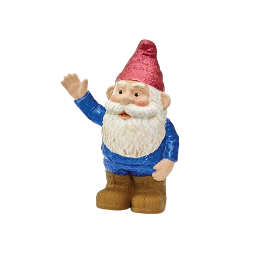

::: about-me
Hi there! {.gnome-pic}
:::

I'm Sarah, a **bioinformatician and data scientist** with 8 years of experience.

I currently work as the lead bioinformatician at **Bough Biosciences**.

I have expertise in conducting a wide range of bioinformatics analyses and specialize in the analysis of **single-cell** gene expression data.

I also have a keen interest in **data visualization** and enjoy developing **R Shiny** apps and R packages.
